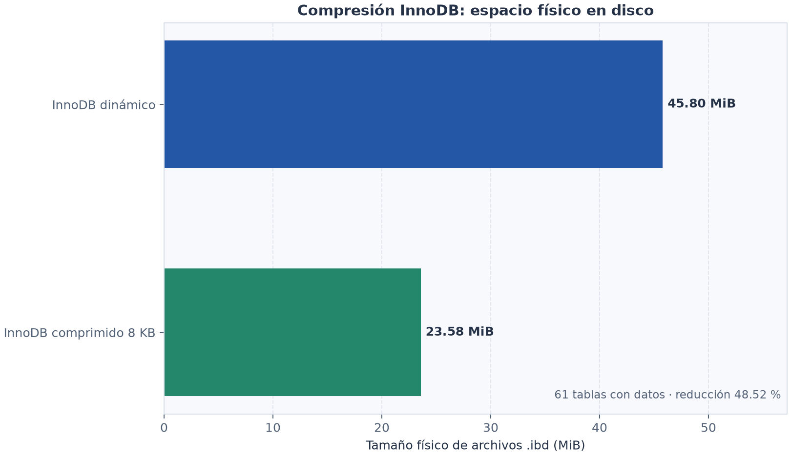
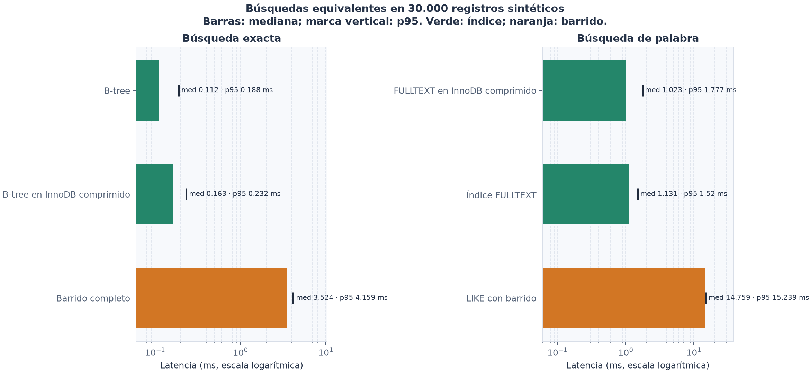
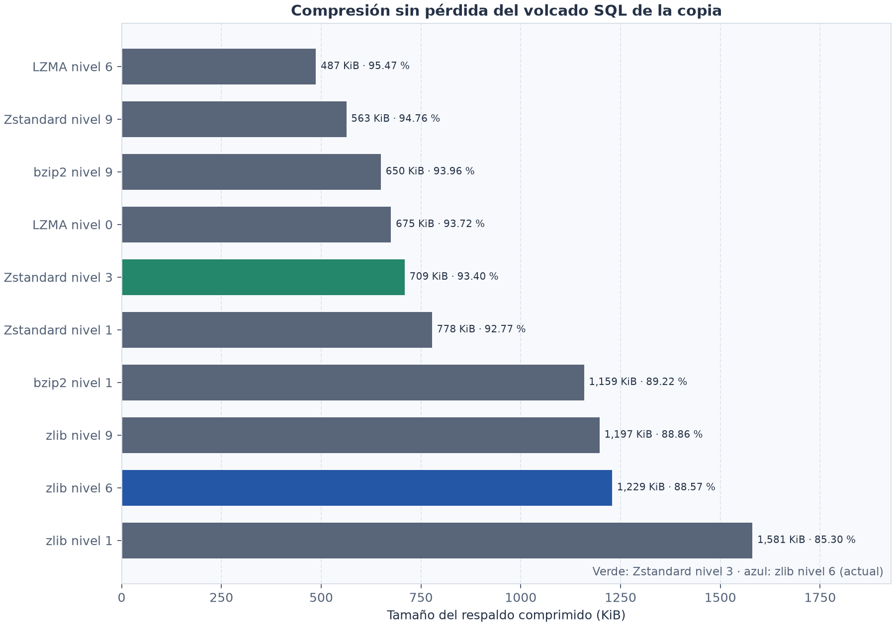

# Pruebas de almacenamiento y búsqueda

Fecha: 2026-11-10  
Motor probado: MariaDB 10.4.32 en Windows 11  
Datos: copia aislada de la base local y tablas de búsqueda con datos sintéticos deterministas. Durante las pruebas comparativas no se modificó la base original.

## Resultados

- Se verificaron 93 tablas de la copia contra el origen mediante conteos y `CHECKSUM TABLE`; no hubo discrepancias.
- En las 61 tablas con datos que se pudieron comparar, los archivos `.ibd` pasaron de 48.021.504 bytes a 24.723.456 bytes al usar `ROW_FORMAT=COMPRESSED KEY_BLOCK_SIZE=8`: reducción física observada de 48,52 %. Las copias comprimidas conservaron los checksums. El resultado depende del motor, tablas y carga; no equivale a una recomendación para habilitarlo en todos los despliegues.
- En tablas sintéticas de 30.000 filas, una búsqueda exacta bajó de 3,524 ms con escaneo a 0,112 ms con índice B-tree. Con la tabla comprimida e índice, la mediana fue 0,163 ms.
- Una búsqueda de palabra bajó de 14,759 ms con `LIKE '%palabra%'` a 1,131 ms con FULLTEXT; la versión comprimida con FULLTEXT obtuvo 1,023 ms. Las tres estrategias devolvieron los mismos 300 IDs en esta consulta. FULLTEXT no es semánticamente idéntico a buscar cualquier subcadena con `LIKE`.
- El volcado SQL original era de 11.009.512 bytes. zlib nivel 6 produjo 1.258.596 bytes; Zstandard nivel 3, 726.307 bytes. Todos los algoritmos comparados se descomprimieron y coincidieron byte por byte.
- En una copia aislada de la base (MariaDB 10.4.32), el índice clínico auxiliar procesó 191 notas con 138.457 bytes de texto. El tamaño físico de los archivos del esquema aumentó de 52.418.268 a 53.420.205 bytes: +1.001.937 bytes (+1,91 %) en esta copia. No es una proyección para otras clínicas; el resultado se conserva en `indice_busqueda_historial.csv`.
- MariaDB no aceptó FULLTEXT directamente sobre la columna JSON existente por su colación binaria. El índice de texto se mantiene en una tabla auxiliar con colación de búsqueda; las filas clínicas originales no se modifican.

## Activación automática en la instalación local

Después de las pruebas, el 10 de noviembre de 2026 se activó el índice FULLTEXT en la base local de XAMPP. Las 191 notas quedaron representadas en el índice, sin modificar las filas originales. Antes del cambio se creó el respaldo `antes_de_migracion`; se verificaron su SHA-256 y el flujo gzip. Esta activación no habilita compresión de tablas.

## Gráficas







## Reproducir

En un entorno virtual de Python, instala las dependencias y ejecuta:

```powershell
python -m venv .venv
.\.venv\Scripts\python.exe -m pip install -r requirements.txt
.\.venv\Scripts\python.exe generar_graficas.py
```

Los gráficos se generan desde los CSV incluidos. Las mediciones de búsqueda corresponden a 41 rondas tras 6 consultas de calentamiento; las tablas se encontraban en caché local, así que los tiempos no predicen directamente el rendimiento con disco frío o bajo concurrencia.

## Interpretación y límites

- Los índices aceleran búsquedas sin que la aplicación descomprima todo un respaldo. El motor lee las páginas e índices requeridos y maneja internamente la descompresión transparente.
- B-tree es apropiado para claves exactas, igualdad y rangos; FULLTEXT sirve para búsqueda textual por términos. Un índice aumenta espacio y coste de escritura, por lo que debe diseñarse para consultas reales.
- La tabla auxiliar FULLTEXT duplica texto de notas y aumenta almacenamiento; la cifra medida fue pequeña en esta copia de 191 entradas, pero puede crecer con el tamaño real de los expedientes.
- La búsqueda nueva exige todos los términos de al menos tres caracteres, usa prefijos FULLTEXT y solo devuelve paciente, título, tipo y fecha; no copia fragmentos de la nota al resultado.
- La compresión de tablas probada es MariaDB/InnoDB y debe pasar validación específica antes de proponerse para MySQL, otras versiones o dispositivos pequeños.
- Zstandard nivel 3 es una alternativa de transferencia/respaldo, no compresión de índices ni búsqueda sobre un archivo comprimido. La aplicación PHP de este XAMPP no tiene extensión zstd habilitada; el código de respaldos continúa usando gzip hasta validar soporte y restauración en los destinos.
- La prueba de almacenamiento usa los archivos de tablas con datos que tenían pareja normal/comprimida; no mide binlogs, archivos adjuntos, espacio temporal, buffer pool, CPU, crecimiento futuro ni desgaste de SSD.
- No se activó ninguna compresión. La búsqueda FULLTEXT sí quedó activa en la instalación local con respaldo previo; su aumento físico exacto puede variar entre bases y se debe medir en cada despliegue.
